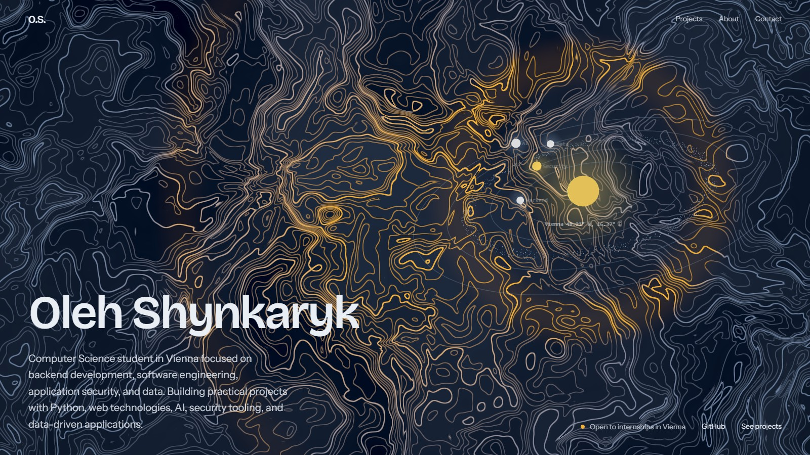
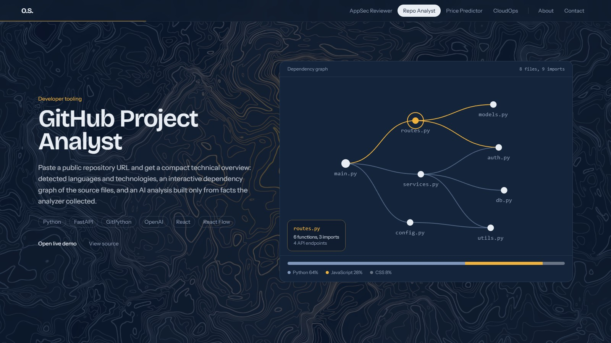

# Oleh Shynkaryk — Portfolio

Personal portfolio of Oleh Shynkaryk, a Computer Science student at the University of Vienna
focused on backend development, application security, data and applied AI. The site presents
four end-to-end projects through animated, scroll-driven scenes, followed by experience,
education, skills and contact details.





## Overview

The page is a single, statically prerendered route built with Next.js and React. Its visual
identity is a survey map: a topographic contour field rendered in a fragment shader sits behind
the whole page, and the hero shows an orbiting system whose planets stand for the main areas of
work. Each project has its own scene that assembles itself as the section comes into view.

### Sections

- **Hero.** Name, short introduction and an interactive orbit scene. On load, the map is
  surveyed outward from the centre while the headline and introduction animate in.
- **Selected work.** Four projects, each with a summary, technology stack, live demo and
  source links. On desktop the panel pins while its scene plays, then releases so the page
  scrolls normally in both directions.
  - *AI AppSec Code Reviewer:* static analysis and LLM review with CWE and OWASP mapping.
  - *GitHub Project Analyst:* repository overview with a dependency graph of source files.
  - *Car Price Predictor:* CatBoost model trained on 762,091 used-car listings.
  - *CloudOps Dashboard:* FastAPI service in Docker on Azure with self-healing health checks.
- **About.** Background, experience and education timelines, skills and languages.
- **Contact.** Email, links and a downloadable CV.

## Technology

| Area        | Tools                                                    |
| ----------- | -------------------------------------------------------- |
| Framework   | Next.js 16 (App Router, Turbopack), React 19, TypeScript |
| Styling     | Tailwind CSS 4, `next/font` (Bricolage Grotesque, Instrument Sans) |
| Animation   | GSAP 3 (ScrollTrigger, SplitText, DrawSVG), Lenis smooth scrolling |
| 3D and WebGL | three.js, React Three Fiber, custom GLSL shaders        |

## Performance and robustness

The page is designed to stay smooth on older and low-cost hardware without removing or
simplifying any animation.

- **Adaptive render resolution.** A shared quality governor
  ([`components/perf/quality.ts`](components/perf/quality.ts)) picks a starting level from the
  device (CPU cores, memory, software rendering) and then tunes it from measured frame times.
  It scales only the pixel ratio of the WebGL canvases, so motion and timing stay identical
  while the GPU load drops on machines that need it.
- **Cheaper compositing on slow devices.** At the lowest levels, translucent panels that blur
  the moving background switch to near-solid fills, removing a per-frame blur pass.
- **WebGL fallback.** Both canvases are wrapped in an error boundary. If WebGL is unavailable or
  fails to start, a static background is shown and the rest of the page works as usual.
- **Work only where it is visible.** The hero scene stops rendering once it leaves the
  viewport; project timelines are built once and only ever play forward.
- **Accessibility.** All motion respects `prefers-reduced-motion`, navigation is fully keyboard
  accessible with a skip link, and the hero stays readable without JavaScript.

## Project structure

```
app/
  layout.tsx              Root layout, fonts, metadata, smooth scrolling
  page.tsx                Page composition
  globals.css             Theme tokens and shared styles
components/
  background/             Full-page topographic shader
  hero/                   Hero section and orbit scene
  projects/               Project panels, content and animated scenes
  about/  contact/  nav/  Remaining sections and navigation
  motion/                 Reusable scroll-reveal hook
  perf/                   Render-quality governor and WebGL boundary
public/
  cv.pdf
docs/screenshots/         Images used in this README
```

Project content (titles, summaries, stacks and links) lives in
[`components/projects/data.ts`](components/projects/data.ts); each scene is a self-contained
component in [`components/projects/scenes`](components/projects/scenes) that exports its view
and a GSAP timeline.

## Getting started

Requirements: Node.js 20.9 or newer and npm.

```bash
npm install
npm run dev
```

The development server runs at http://localhost:3000.

| Command         | Description                            |
| --------------- | -------------------------------------- |
| `npm run dev`   | Start the development server           |
| `npm run build` | Create an optimized production build   |
| `npm run start` | Serve the production build             |
| `npm run lint`  | Run ESLint                             |

## Deployment

The site prerenders to static content and can be deployed to any platform that supports
Next.js, such as Vercel, with the default build settings.

## Contact

- GitHub: [olegicks](https://github.com/olegicks)
- LinkedIn: [Oleh Shynkaryk](https://www.linkedin.com/in/oleh-shynkaryk-090134283/)
- The email address and CV are available in the contact section of the site.
